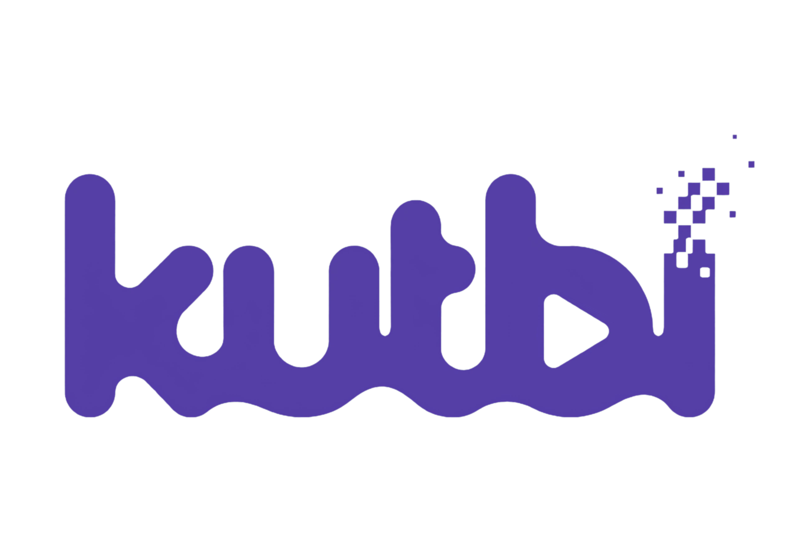
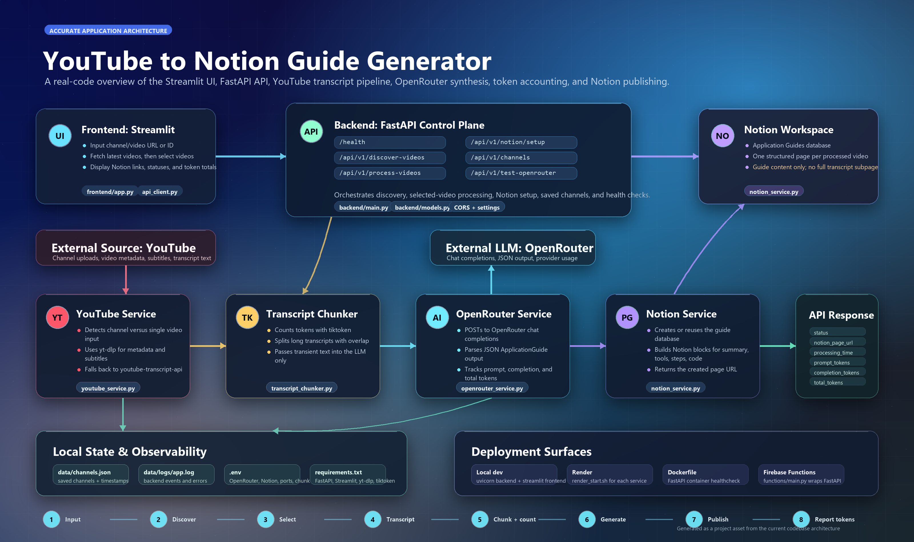

# Kutbi

<p align="center">
  
</p>

<p align="center">
  <strong>Turn YouTube technical videos into structured, actionable Notion Application Guides — automatically.</strong>
</p>

<p align="center">
  <a href="#getting-started"></a>
  <a href="#architecture"></a>
  <a href="#architecture"></a>
  <a href="#features"></a>
  <a href="#features"></a>
</p>

<p align="center">
  <em>Discover → Transcribe → Synthesize → Publish. Your personal technical library, built from the videos you already watch.</em>
</p>

## Table of Contents

- [What is Kutbi?](#what-is-kutbi)
- [Why Kutbi?](#why-kutbi)
- [Features](#features)
- [How It Works](#how-it-works)
- [Architecture](#architecture)
- [Getting Started](#getting-started)
- [Configuration](#configuration)
- [Usage](#usage)
- [API Reference](#api-reference)
- [Deployment](#deployment)
- [Project Structure](#project-structure)
- [Tech Stack](#tech-stack)
- [Contributing](#contributing)
- [License](#license)
- [Acknowledgements](#acknowledgements)

## What is Kutbi?

Kutbi is an end-to-end AI pipeline that converts YouTube technical videos into structured, reusable **Application Guides** stored in Notion. Give it a channel URL, a handle, or a single video link, and it discovers uploads, extracts transcripts, distills them with an LLM into a consistent guide format (big idea, key terms, tools, 5-minute actions, implementation steps, code snippets, resources, timestamps), and publishes each guide as a clean Notion page — complete with syntax-highlighted code blocks and a status tracker.

It is built as two cooperating services: a **FastAPI backend** that owns all heavy lifting (YouTube discovery/transcription, LLM synthesis, Notion export, persistence) and a **Streamlit frontend** that provides a calm, guided workspace for selecting videos and reviewing results.

## Why Kutbi?

Technical videos are dense. Re-watching them to find "the one command" or "the architecture decision" wastes time. Kutbi turns passive watching into an active, searchable knowledge base:

- **Consistent structure** — every guide follows the same schema, so your Notion database stays comparable and searchable.
- **Provider choice** — switch between OpenRouter (any OpenAI-compatible model) and Google Gemini without code changes.
- **Long-form ready** — transcripts longer than the model context are chunked with overlap and merged automatically.
- **Resilient** — YouTube cookies, transcript API fallback, retry/backoff HTTP, and graceful per-video failure handling.
- **Deploy anywhere** — runs locally, in Docker, on Render, or as a Firebase Cloud Function.

## Features

- **YouTube integration** — accepts channel IDs, `@handles`, channel/video URLs, and raw video IDs. Discovers latest uploads via `yt-dlp`.
- **Smart transcription** — pulls manual/auto subtitles through `yt-dlp`, parses JSON3, and falls back to `youtube-transcript-api` with configurable language preferences.
- **AI synthesis** — produces a structured `ApplicationGuide`: big idea, key terms, tools & apps, 5-minute actions, implementation steps, code snippets (verbatim or suggested), resources, key timestamps.
- **Notion export** — creates/verifies a database with rich properties (Title, Channel, Views, URL, Date, Duration, Status, Tokens) and appends paragraph, heading, bulleted, numbered, code, and divider blocks.
- **Provider & model override** — choose provider/model per request or via environment variables.
- **Chunking & merging** — tiktoken-based sentence-aware chunking with overlap for long transcripts; partial guides are merged deterministically.
- **Concurrency & limits** — configurable max videos per channel and concurrent processing.
- **Health checks** — `/health` reports status of the active LLM provider and Notion.
- **Saved channels** — processed channels are persisted to `data/channels.json` for quick re-runs.
- **Calm UI** — Streamlit workspace with discovery, video selection, progress tracking, result cards, and Notion links.


## How It Works

1. **Discover** — You paste a YouTube source. Kutbi resolves it to a channel or single video and lists recent uploads.
2. **Select** — You pick which videos to turn into guides (all selected by default).
3. **Transcribe** — For each video, Kutbi fetches and cleans the transcript (cookies-aware, with API fallback).
4. **Synthesize** — The transcript is chunked if needed and sent to your chosen LLM, which returns a structured guide as JSON.
5. **Publish** — The guide is rendered into Notion blocks and saved to your database; results and token usage are returned to the UI.

### Pipeline Diagram

<p align="center">
  
</p>

<p align="center"><sub>End-to-end flow: YouTube → transcript → LLM synthesis → Notion, orchestrated by FastAPI and surfaced through Streamlit.</sub></p>

## Architecture

Kutbi follows a clean service-oriented layout. The frontend never talks to YouTube/LLM/Notion directly — it calls the FastAPI backend, which composes the services.

| Layer | Component | Responsibility |
| --- | --- | --- |
| Frontend | `frontend/app.py` | Streamlit entry point, session state, sidebar settings, header |
| Frontend | `frontend/api_client.py` | HTTP client with retry/backoff and backend URL fallback |
| Frontend | `frontend/components/*` | Channel input, progress tracking, result cards |
| Backend | `backend/main.py` | FastAPI app, routes, request orchestration, health checks |
| Backend | `backend/models.py` | Pydantic request/response and guide schemas |
| Backend | `backend/config.py` | pydantic-settings configuration from `.env` |
| Service | `YouTubeService` | Discovery, metadata, transcript extraction |
| Service | `OpenRouterService` / `GeminiService` | LLM synthesis, chunking, JSON repair |
| Service | `NotionService` | Database setup, page creation, block rendering |
| Service | `StorageService` | Local JSON persistence of channels |
| Utility | `TranscriptChunker` | tiktoken counting, sentence-aware chunking, overlap |
| Utility | `logger` | Centralized console + file logging |
| Deploy | `backend/Dockerfile`, `functions/main.py` | Container & Firebase Cloud Function wrappers |

### Request Flow

```text
Streamlit UI -> APIClient -> FastAPI -> YouTubeService (yt-dlp / transcript-api)
                                   |---> LLM Service (OpenRouter or Gemini)
                                   |---> NotionService (notion-client)
                                   '---> StorageService (data/channels.json)
```

## Getting Started

### Prerequisites

- Python 3.10+ (3.11 recommended for Docker)
- A Notion integration token (required)
- An API key for **either** OpenRouter or Gemini (required for synthesis)
- Optional: a `cookies.txt` file in the project root for YouTube videos that require sign-in

### Installation

```bash
# 1. Clone
git clone https://github.com/abm1119/Kutbi.git
cd Kutbi

# 2. Virtual environment
python -m venv .venv
# Windows
.venv\Scripts\activate
# macOS / Linux
source .venv/bin/activate

# 3. Dependencies
pip install -r requirements.txt
```

### Configuration

Create a `.env` file in the project root:

```env
# Required
NOTION_API_KEY=secret_...
# Choose one (or both) LLM providers
OPENROUTER_API_KEY=sk-or-...
GEMINI_API_KEY=...

# Optional
LLM_PROVIDER=openrouter
OPENROUTER_MODEL=openai/gpt-4o-mini
GEMINI_MODEL=gemini-2.5-flash
NOTION_DATABASE_ID=
MAX_VIDEOS_PER_CHANNEL=5
MAX_CONCURRENT_VIDEOS=3
TRANSCRIPT_LANGUAGES=en,en-US,en-GB
LOG_LEVEL=INFO
```

See the full variable reference in [Configuration](#configuration).

### Running Kutbi

In two terminals:

```bash
# Terminal 1 - backend
python -m backend.main
# FastAPI listens on http://127.0.0.1:7860 by default

# Terminal 2 - frontend
streamlit run frontend/app.py
# Streamlit opens http://localhost:8501
```

Then open the Streamlit URL, paste a YouTube source in the **Discovery** tab, review the candidate videos, and click **Build selected guides**.

## Configuration

All settings are loaded by `backend/config.py` via pydantic-settings from `.env`. Defaults are shown below.

| Variable | Required | Default | Description |
| --- | --- | --- | --- |
| `NOTION_API_KEY` | Yes | — | Notion integration secret (`notion_api` / `notion_token` also accepted) |
| `OPENROUTER_API_KEY` | If using OpenRouter | — | OpenRouter API key |
| `GEMINI_API_KEY` | If using Gemini | — | Google Gemini API key (`GOOGLE_API_KEY` also accepted) |
| `NOTION_DATABASE_ID` | No | auto-create | Existing Notion database ID; created at runtime if empty |
| `LLM_PROVIDER` | No | `openrouter` | `openrouter` or `gemini` |
| `OPENROUTER_MODEL` | No | `openrouter/free` | OpenRouter model ID |
| `OPENROUTER_BASE_URL` | No | `https://openrouter.ai/api/v1` | OpenRouter API base URL |
| `OPENROUTER_SITE_URL` | No | `http://localhost` | Referer sent to OpenRouter |
| `OPENROUTER_APP_NAME` | No | `YouTube-to-Notion Guide Generator` | App name sent to OpenRouter |
| `GEMINI_MODEL` | No | `gemini-2.5-flash` | Gemini model ID |
| `GEMINI_BASE_URL` | No | `https://generativelanguage.googleapis.com/v1beta` | Gemini API base URL |
| `BACKEND_HOST` | No | `0.0.0.0` | FastAPI bind host (`backend_host`) |
| `BACKEND_PORT` / `PORT` | No | `7860` | FastAPI bind port |
| `STREAMLIT_PORT` | No | `8501` | Streamlit port (frontend config) |
| `MAX_VIDEOS_PER_CHANNEL` | No | `5` | Max videos fetched per channel |
| `MAX_CONCURRENT_VIDEOS` | No | `3` | Reserved for concurrent processing |
| `MAX_TOKENS_PER_CHUNK` | No | `15000` | Token budget per LLM chunk |
| `RESPONSE_MAX_TOKENS` | No | `8192` | Max tokens for LLM response |
| `REQUEST_TIMEOUT` | No | `600` | External API timeout (seconds) |
| `TRANSCRIPT_LANGUAGES` | No | `en,en-US,en-GB` | Preferred transcript languages |
| `LOG_LEVEL` | No | `INFO` | Logging level |

## Usage

### Web UI

1. Start backend + frontend (see [Running Kutbi](#running-kutbi)).
2. In the sidebar, optionally set a Notion database ID, choose an AI provider, and override the model.
3. Paste a channel URL/handle/ID or a single video URL/ID into **Discovery**.
4. Click **Discover** (auto-runs on input) to list candidate videos.
5. Review and (de)select videos, then **Build selected guides**.
6. Watch progress; when done, open the generated Notion pages from the **Results** tab.

### Programmatic (API)

```bash
# Health
curl http://127.0.0.1:7860/health

# Discover videos
curl -X POST http://127.0.0.1:7860/api/v1/discover-videos \
  -H 'Content-Type: application/json' \
  -d '{"source_input": "@Fireship", "max_videos": 5}'

# Process selected videos
curl -X POST http://127.0.0.1:7860/api/v1/process-videos \
  -H 'Content-Type: application/json' \
  -d '{"source_input": "@Fireship", "selected_video_ids": ["VIDEO_ID"], "llm_provider": "gemini"}'
```

Interactive OpenAPI docs are available at `http://127.0.0.1:7860/docs`.

## API Reference

| Method | Path | Purpose |
| --- | --- | --- |
| `GET` | `/health` | Service health + provider/Notion status |
| `POST` | `/api/v1/discover-videos` | Discover latest uploads or inspect a single video |
| `POST` | `/api/v1/process-videos` | Process selected videos into Notion guides |
| `POST` | `/api/v1/process-channel` | Backward-compatible channel processing |
| `GET` | `/api/v1/channels` | List saved channels |
| `POST` | `/api/v1/notion/setup` | Create or verify the Notion database |
| `POST` | `/api/v1/test-youtube` | Debug YouTube discovery |
| `POST` | `/api/v1/test-openrouter` | Debug OpenRouter synthesis |
| `POST` | `/api/v1/test-gemini` | Debug Gemini synthesis |
| `POST` | `/api/v1/test-llm` | Debug the configured LLM provider |

## Deployment

### Docker

```bash
docker build -f backend/Dockerfile -t kutbi .
docker run -p 8080:8080 --env-file .env kutbi
```

Note: the Dockerfile installs `requirements.txt` from the repo root and runs `uvicorn backend.main:app` on port 8080.

### Render / Cloud

- Backend: set `RENDER=true` and `FRONTEND_URL` for CORS; bind to `$PORT`.
- Frontend: deploy Streamlit separately and point `BACKEND_URL` at the backend.

### Firebase Cloud Functions

`functions/main.py` wraps the FastAPI app for Firebase/GCP Cloud Functions (with CORS handling). Deploy with the Firebase CLI using `functions/requirements.txt`.

## Project Structure

```text
YtVideoGuides/
├── assets/                       # Brand assets (logo, icons)
│   ├── kutbi_purple.png          # Primary logo used in README/UI
│   ├── kutbi-logo.svg
│   └── ...
├── backend/
│   ├── config.py                 # pydantic-settings
│   ├── main.py                   # FastAPI app & routes
│   ├── models.py                 # Pydantic schemas
│   ├── Dockerfile
│   ├── services/                 # youtube, llm, notion, storage
│   └── utils/                    # logger, transcript_chunker
├── frontend/
│   ├── app.py                    # Streamlit entry point
│   ├── api_client.py             # Backend HTTP client
│   ├── components/               # UI components
│   ├── assets/                   # architecture-overview.png (diagram)
│   └── .streamlit/config.toml    # Theme
├── functions/
│   ├── main.py                   # Firebase Cloud Function wrapper
│   └── requirements.txt
├── data/
│   ├── channels.json             # Saved channels
│   └── logs/app.log
├── .streamlit/config.toml        # Design system theme
├── app.json                      # Env var manifest
├── requirements.txt              # Python dependencies
├── .env                          # (gitignored) secrets
└── README.md
```

## Tech Stack

- **Backend:** FastAPI, Uvicorn, Pydantic, pydantic-settings
- **Frontend:** Streamlit
- **YouTube:** yt-dlp, youtube-transcript-api
- **AI:** OpenRouter (OpenAI-compatible) and Google Gemini, tiktoken for chunking
- **Export:** notion-client
- **HTTP:** requests, httpx
- **Deploy:** Docker, Render, Firebase Cloud Functions (functions-framework, asgiref, starlette, werkzeug)

## Contributing

Contributions are welcome. To get started:

1. Fork the repo and create a feature branch.
2. Install dependencies and run the backend + frontend locally.
3. Keep changes focused; match existing code style and service boundaries.
4. Open a pull request with a clear description and screenshots for UI changes.

Please avoid committing secrets (`.env`, `cookies.txt`) — they are gitignored.

## License

No license file is currently included in the repository. All rights are reserved by the author unless stated otherwise. If you intend to use or redistribute this project, please contact the maintainer.

## Acknowledgements

- Built with [FastAPI](https://fastapi.tiangolo.com/), [Streamlit](https://streamlit.io/), [yt-dlp](https://github.com/yt-dlp/yt-dlp), [youtube-transcript-api](https://github.com/jdepoix/youtube-transcript-api), [notion-client](https://github.com/ramnes/notion-sdk-py), [tiktoken](https://github.com/openai/tiktoken), [OpenRouter](https://openrouter.ai/), and [Google Gemini](https://ai.google.dev/).
- Brand assets live in `assets/` and `frontend/assets/`.

---

*Made with care to turn watched videos into remembered knowledge.*

